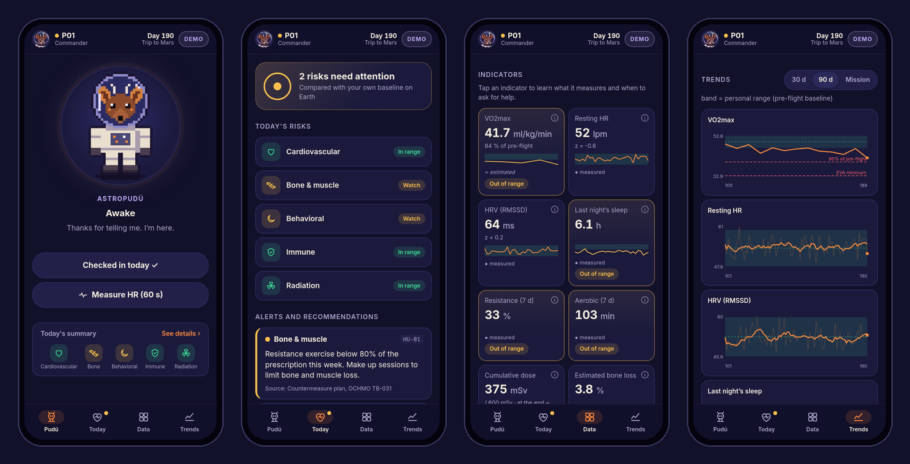
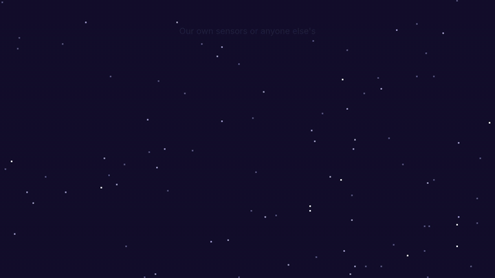
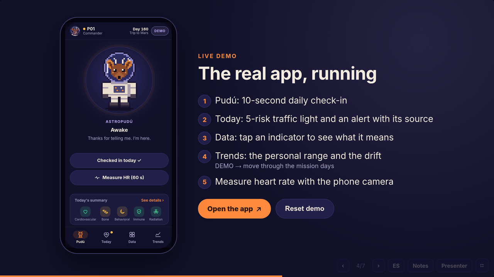

<p align="center">
  
</p>

# PuduHealth · TecMedHub · NASA Space Apps Challenge 2026

> 🇬🇧 English · 🇨🇱 [Español](README.es.md)

**Challenge:** [Create Health Monitoring Software for Astronauts on Space Missions](https://www.spaceappschallenge.org/2026/challenges/health-monitoring-software/)
**Team:** [TecMedHub](https://www.spaceappschallenge.org/2026/find-a-team/tecmedhub/) · **Local event:** Quemchi, Chiloé, Chile

<p align="center">
  <a href="https://tecmedhub.github.io/puduhealth/app/?lang=en"><b>▶&nbsp;Open the app</b></a> &nbsp;·&nbsp;
  <a href="https://tecmedhub.github.io/puduhealth/pitch/"><b>🎤&nbsp;Pitch (7 slides)</b></a> &nbsp;·&nbsp;
  <a href="https://tecmedhub.github.io/puduhealth/app/?lang=en&demo=1"><b>🚀&nbsp;Example Mars mission</b></a> &nbsp;·&nbsp;
  <a href="https://tecmedhub.github.io/puduhealth/"><b>🌐&nbsp;Project site</b></a>
</p>

<p align="center">
  <a href="https://tecmedhub.github.io/puduhealth/app/?lang=en&demo=1"></a>
</p>

| 30-second video (from the real app) | Pitch with the live app inside |
|---|---|
| <a href="https://tecmedhub.github.io/puduhealth/"></a> | <a href="https://tecmedhub.github.io/puduhealth/pitch/"></a> |
| English [16:9](video/salida/puduhealth-en-horizontal.mp4) · [9:16](video/salida/puduhealth-en-vertical.mp4) · Spanish [16:9](video/salida/puduhealth-es-horizontal.mp4) · [9:16](video/salida/puduhealth-es-vertical.mp4) | English: [pitch/](https://tecmedhub.github.io/puduhealth/pitch/) · Spanish: [pitch/es/](https://tecmedhub.github.io/puduhealth/pitch/es/) |

On a phone, open the app and choose *Install*: it then works like any other app, also offline.

---

## In 30 seconds

**PuduHealth is an onboard health app that compares each astronaut with their own baseline and
warns weeks before a standard limit is crossed.** It tells the person who has to act what to do and
when to call the crew medical officer, cites the source of every recommendation, keeps the answers
private and encrypted on the device, and works with no link to Earth.

| | |
|---|---|
| **Impact** | Fixed limits warn late. In the simulated Mars mission, the first personal warnings come **55 days before** the NASA VO2max limit is crossed, while there is still time to correct course. The same approach fits rural health posts in Chiloé, where we built it |
| **Creativity** | Each person is their own reference. Answers stay with the astronaut, a companion rewards habits without judging feelings, and an ordinary phone camera is the first sensor |
| **Validity** | Deterministic rules with cited thresholds. Drift detector calibrated on real data (14 people, ~5 months). Heart rate from the app's PPG algorithm within 0.8 bpm of chest ECG. 64 automated tests |
| **Relevance** | It gathers indicators, evaluates five NASA risks, shows trends and recommends actions. The scenario is built on NASA standards, OCHMO briefs and Curiosity's MSL RAD radiation measurements |
| **Presentation** | An installable phone app in Spanish and English. Every indicator explains itself, and an example mission shows the whole system in one minute |
| **Personal data** | Health data never leaves the phone: AES-256 encryption, an optional PIN, no server, accounts or analytics. See, export or delete at any time. [How we handle data](docs/privacidad.en.md) |

---

## 1. Impact: the problem and the change it makes

### The problem

On a mission to Mars, nobody on Earth can watch each astronaut's health day by day, and help is
months away. Three things make this worse today:

- **Fixed limits warn late.** A threshold such as "VO2max below 80 % of the pre-flight value"
  fires when the loss has already happened. People differ widely, so a population limit is
  either too loose for some or too strict for others.
- **Symptoms go unreported.** Astronauts are known to under-report physical and behavioral
  symptoms to flight surgeons, fearing it may cost them future flights (Institute of Medicine 2001;
  NASA OCHMO-TB-014).
- **The link fails.** Every two years the Sun blocks communication with Mars for about two weeks
  (solar conjunction). Software that needs the ground stops helping exactly then.

### What changes with PuduHealth

- **Earlier, personal warnings.** Each value is compared with the astronaut's own range. A
  sustained drift is flagged as amber long before a standard's red line. In the example mission,
  the commander's first ambers (short sleep, then resistance training falling behind) arrive 55
  days before the VO2max limit.
- **The person who can act is told.** Exercise and sleep are up to the astronaut. The app shows
  them their own trend every day, what to do and why, instead of waiting for someone on Earth to
  notice it in downlinked data.
- **Private by design.** Detailed answers never leave the device, encrypted with AES-256. In a
  mission, the medical officer would see only the traffic light, with the astronaut's permission
  (designed, not built yet). A sober clinical screen says when to call them (fever, depression
  screening).
- **Autonomous.** Everything runs on board, offline, on the astronaut's own device.

### Back on Earth: Chiloé

We built this in Quemchi, in the Chiloé archipelago, where the same problem exists closer to home.
On the islands of the commune, rural health posts are run by paramedic technicians. Doctors and
specialists arrive by sea on scheduled rounds, and bad weather can delay a boat.

| On the way to Mars | On an island of Quemchi |
|---|---|
| A crew medical officer, not a physician | A paramedic technician at the rural health post |
| A fixed limit flags a problem once it already exists | A patient with hypertension or diabetes can drift for weeks between rounds |
| Nobody on Earth watches each astronaut's daily trend | The doctor sees the patient on the next round |
| Evacuation is not an option | A boat, when the weather allows |

The question is the same in both places: *is this normal for this person, what do I do, and when
do I call?* The same engine (personal baseline, cited rules, when to call) could support a rural
health post with a different rule set. One piece already works there today: heart rate measured
with an ordinary phone camera, as the people in the open Welltory dataset did at home. The rest is
a direction we have not built or tested yet, because the current rules are written for astronauts.

Local context: [specialist round by sea at Isla Tac, Quemchi](https://www.minsal.cl/exitoso-operativo-dental-y-de-especialistas-en-isla-tac/) (Chilean Ministry of Health, 2017).

**Footprint.** The app is a set of static files (HTML, JavaScript and a 1.6 KB model). It needs
no servers, no cloud and no accounts. It runs on a modest phone, offline, and any web server can
deliver it, from GitHub Pages to a computer on board.

---

## 2. Creativity: what is new about it

- **Each person is their own reference.** Most monitoring compares people with a population. The
  app learns each astronaut's range before the mission and watches for drift from it. In
  *My record*, anyone starts their own: the first 7 days calibrate the baseline, and from day 8
  every value is compared with it.
- **Privacy as a health measure, not only a policy.** The design starts from the evidence that
  astronauts hide symptoms. Keeping answers on the device is meant to make honest reporting more
  likely.
- **A companion that rewards habits, not feelings.** **Astropudú** is a pixel-art astronaut pudú
  (the world's smallest deer, native to Chiloé), designed by the team and drawn in code in the app. It reacts to logging, sleep and
  exercise. It never reacts to the emotional content of the answers and it never punishes. When a
  clinical screen appears, it steps aside.
- **A missing value is not a zero.** If something has not been measured, the card says how to get
  it (daily check-in, camera, onboard equipment) instead of showing a misleading number. Weekly
  rules wait for a full week of history.
- **The phone is the first sensor.** A 60-second measurement with the camera and flash gives resting
  heart rate and heart rate variability, with motion checked through the accelerometer.
- **One open door for any data.** Every source (camera, file, another system, a future chest strap)
  sends measurements in one format, and the engine treats them the same.
- **Real radiation, replayed.** The example crew lives day by day what Curiosity's RAD instrument
  measured on its way to Mars and on the surface, including the solar storms it recorded.

---

## 3. Validity: science and feasibility

### How it decides

```
MEASURE ──► ESTIMATE (personal baseline, z-score, EWMA trend) ──► DECIDE (cited rules) ──► ACT
```

- **Personal baseline.** For each variable: mean and standard deviation of the person's baseline
  days, the z-score of every new value, and an EWMA trend. A variable is flagged when two values
  in a row reach z ≥ 2 in the unfavorable direction, or when the EWMA stays at ≥ 1.5 for 10
  measurements.
- **Many variables, combined in the open.** The app records 17 kinds of measurement. Eight of them
  (resting heart rate, HRV, VO2max, sleep, mood, sleepiness, PHQ-9, temperature) get their own
  baseline and drift detector. The rules combine them explicitly: an infection alert needs two of
  heart rate, temperature and symptoms to agree.
- **Models only estimate; rules recommend.** The 14 rules are deterministic, auditable and cited.
  Machine learning calibrates the detector and estimates acute stress. A model mixing all the
  variables did not do better on real data ([`ml/README.md`](ml/README.md), section 5, Spanish).
- **Amber** means a sustained deviation from the person's own range. **Red** means a threshold from
  a standard or guideline has been crossed. Rules and sources: [`app/js/reglas.js`](app/js/reglas.js)
  (Spanish and English) and the [project plan](docs/plan.en.md).

### Evidence

| What | Result | Data |
|---|---|---|
| Drift detector, false alarms | 2.5 % of days with a heart-rate alert in daily life | PMData, 14 people, ~5 months |
| Drift detector, sensitivity | A sustained +5 bpm rise is flagged in 3 days (median) | PMData with an added rise |
| Heart rate from the app's PPG algorithm | Median error of 0.8 bpm against chest ECG at rest | WESAD |
| Acute stress model | AUC 0.93 leaving one person out | WESAD, 15 people |
| Immune rules | 100 % of simulated illnesses detected, median delay 1 day, 0.05 % of healthy days with an alert | 30 simulated missions |
| Heart-rate signal in real infections | Median rise of +2 bpm, used to tune the simulator | Welltory COVID-19 open data |
| Code | 64 automated tests (engine, rules, input, simulator, offline cache, personal mode, encryption) | `cd app && npm test` |

Scripts and full results: [`ml/README.md`](ml/README.md) (Spanish).

### Feasible today

- **Runs anywhere.** Static files with no backend. Installable as a phone app (web app manifest
  and service worker) and fully usable offline after the first visit.
- **Open format.** `{ tipo, valor, persona?, dia?, fuente?, calidad? }`. Units are checked, so a
  temperature in °F is rejected instead of entering wrong. There are three ways in: the phone
  camera, a JSON / JSON Lines / CSV file (*Settings → My data → Import*) and
  `window.astroHealth.registrar(...)` from the same page. Spec: [`docs/conexion.md`](docs/conexion.md) (Spanish).
- **Encrypted at rest.** AES-GCM 256-bit with a non-exportable device key, or a key derived from an
  optional PIN (PBKDF2-SHA-256, 600,000 iterations). Details and limits: [personal data handling](docs/privacidad.en.md).
- **Path to hardware.** We propose the standard Bluetooth Low Energy Heart Rate and Health
  Thermometer profiles, so any compliant chest strap or watch would work. That adapter is not built
  yet.

### What is real and what is simulated

| Real | Simulated |
|---|---|
| *My record*: your own check-ins, sleep and exercise logs and camera measurements, stored only on your device | *Example mission*: a four-person crew (`app/js/simulador.js`, reproducible from a seed) on a full 860-day Mars mission, or the 210-day outbound trip shown in the video (`?escenario=transito`) |
| Heart rate measured with the phone camera | Illness, sleep loss and conflict events in the example crew |
| Stress model and drift detector, trained and calibrated on public data | Radiation dose, from MSL RAD dose rates in transit and on the surface |

**This is a hackathon prototype. It is not a medical device and has not been clinically
validated.** Limitations are listed in the [project plan](docs/plan.en.md), section 13.

---

## 4. Relevance: the challenge and the data

### What the challenge asks, and where it is

| The astronaut… | How |
|---|---|
| gathers indicators | A 10-second daily check-in (mood, sleepiness, sleep, exercise, symptoms, temperature) and a 60-second heart-rate measurement with the phone camera |
| evaluates | A traffic light for five risks (cardiovascular, bone and muscle, behavioral, immune, radiation) and trends drawn against the personal range |
| acts | Each alert gives the action and its source. A sober clinical screen appears when the medical officer should be contacted |
| understands | Tapping any indicator explains what it is, how it is measured in space, why it matters there, the related NASA spaceflight hazards, when to ask for help and what to do |
| keeps going | Astropudú, and a check-in short enough to do every day |

### NASA data and resources

| Resource | Use |
|---|---|
| NASA-STD-3001 Vol. 1 Rev. C | VO2max thresholds, career radiation limit, limits expressed as % of the pre-mission value |
| OCHMO technical briefs TB-030 (bone loss), TB-031 (exercise), TB-020 (radiation) | Bone-loss rate, exercise prescription, dose limits |
| MSL RAD on Curiosity (Zeitlin et al. 2013; Hassler et al. 2014; Guo et al. 2015), raw data in NASA's Planetary Data System | The example crew lives what Curiosity measured, day by day: the cruise dose rate and its five solar storms, then the surface rate and the solar storm of sol 242. Also drives the dose projection |
| Mars Design Reference Architecture 5.0 (NASA, 2009) | Shape of the full mission: about 180 days out, 500 on the surface, 180 back |
| NASA Human Research Program: [5 hazards](https://www.nasa.gov/hrp/hazards/), [risks](https://www.nasa.gov/hrp/risks/), [ongoing research](https://www.nasa.gov/hrp/ongoing-hrp-research/) | Choice of risks; hazards shown in each explanation |
| Earth Independent Medical Operations (EIMO) | NASA's call for onboard clinical decision support with trends and early alerts |
| OCHMO-TB-014 Behavioral Health Mishaps (2023) | Astronauts' reluctance to report behavioral health problems; why answers stay private |
| NASA-funded studies: Moore et al. 2014 (VO2peak on the ISS), Barger et al. 2014 (sleep in spaceflight), Mehta et al. 2017 (latent virus reactivation) | Explanations and immune rules |

### Other scientific sources

| Resource | Use |
|---|---|
| Canadian Space Agency: [Bio-Monitor](https://asc-csa.gc.ca/eng/sciences/astroskin.asp), [radiation monitoring](https://www.asc-csa.gc.ca/eng/news/articles/2026/2026-02-26-monitoring-radiation-astronaut-health.asp), [science in space](https://www.asc-csa.gc.ca/eng/iss/science/why-do-we-conduct-science-experiments-in-space.asp) | What can be measured on board |
| WESAD (Schmidt et al. 2018) | Training of the acute-stress model, the only trained model |
| PMData (Thambawita et al. 2020) | Calibration of the personal-baseline detector |
| Welltory COVID-19 and Wearables Open Data (CC0) | Test of the heart-rate signal on real infections |
| AASM/SRS 2015, Kroenke et al. 2001 (PHQ-9), WHO 2020, Cohen et al. 2009, Stahn et al. 2017 | Thresholds and explanations |
| Institute of Medicine 2001, *Safe Passage: Astronaut Care for Exploration Missions* | Under-reporting of symptoms to flight surgeons for fear of losing future flights |

Third-party datasets are not stored in this repository, only the code that downloads and
processes them. Full list with links: [project plan](docs/plan.en.md), section 15.

---

## 5. The app

- **Phone first, installable.** Four sections in a bottom bar: **Pudú** (companion, check-in,
  measurement), **Today** (overall status, five risks, alerts), **Data** (indicators with a
  30-day trend) and **Trends** (charts you can read with a finger, over 30 days, 90 days or the
  whole mission). On wide screens they sit together in two columns.
- **Two modes.** *My record* is the app itself, with your own data on your device. *Example
  mission* shows the simulated crew; there you can pick a crew member and move through the days.
  You choose at the end of the introduction and can switch in Settings.
- **Spanish and English** (`?lang=en`). Three color themes drawn from the project's own story:
  Astropudú, Chiloé and Mars.
- **Your data stays yours.** Encrypted on the device, with an optional PIN. Export it in the open
  format, or delete it. *Settings → How we handle your data* explains it in the app.

---

## 6. Personal data

PuduHealth handles health data, which is sensitive data. In short:

| | |
|---|---|
| **What** | Only what the person logs and the result of camera measurements. Camera images are never stored |
| **Where** | Only on the person's device. No server, accounts, ads or analytics; the app sends no personal data anywhere |
| **How** | AES-GCM 256-bit encryption at rest; key wrapped by a non-exportable device key or by an optional PIN |
| **How long** | Until the person deletes it; deleting removes the data and the key |
| **Rights** | Access, correction, deletion and portability (export in the open format), from Settings |
| **Our study** | The pulse-meter tool used pseudonymous participant codes, informed consent, server storage out of web reach, and deletion on request or after 12 months |

Full policy, legal framework (Chile Laws 19.628, 21.719 and 20.584; GDPR Articles 9 and 25) and
known limits: [personal data handling](docs/privacidad.en.md).

---

## Repository

| Folder | Content |
|---|---|
| [`index.html`](index.html) | Project site: links to the app and the pitch, and the videos |
| [`app/`](app/) | The web app: personal baseline, rules engine, interface, companion, camera measurement, simulator, with tests |
| [`ml/`](ml/) | Training, calibration and evaluation scripts on public datasets |
| [`docs/`](docs/) | Project plan in [English](docs/plan.en.md) and [Spanish](docs/plan.es.md): idea, rules, sources, limitations. [Personal data handling](docs/privacidad.en.md) ([Spanish](docs/privacidad.es.md)). Data connection spec (Spanish) |
| [`pitch/`](pitch/) | The 7 pitch slides (HTML, Spanish and English), with the live app inside |
| [`video/`](video/) | The 30-second demo video in English and Spanish, 16:9 and 9:16 (Instagram), and its generator, recorded from the real app. Original soundtrack composed by Benjamín Catipillan-Ulloa |
| [`pulsometro/`](pulsometro/) | First prototype: camera heart-rate monitor used to collect our own recordings (HTML + PHP) |

## Run it

```bash
python3 -m http.server 8080      # from the repository root
# open http://localhost:8080/app/?lang=en

cd app && npm test               # Node 20 or later
```

The camera and encryption need HTTPS (or `localhost`): `cd app && npm run https` serves it on the
local network. Slides: <http://localhost:8080/pitch/>.

### Publish on GitHub Pages

Everything is static, so GitHub Pages serves it as is: in the repository, *Settings → Pages →
Deploy from a branch → `main` / root*. The app is then at `https://<user>.github.io/<repo>/app/`
and the slides at `.../pitch/` (English; Spanish at `.../pitch/es/`), both over HTTPS.

---

## Team

| Name | Space Apps |
|---|---|
| Nicolás Baier Quezada (owner) | `@debaq` |
| Vanessa Soledad Uribe Hernández | `@vanessa_uribe` |
| Benjamín Catipillan-Ulloa | `@pukem` |
| Haydeé Valentina Barrientos Toledo | `@chochoca` |
| Fernanda Andrea López Moncada | `@fernandandrea` |

## About TecMedHub

Applied science lab at Universidad Austral de Chile (Puerto Montt). We solve real problems with technology, from the south of Chile. Open source.

🌐 [tecmedhub.org](https://tecmedhub.org) · 💻 [github.com/TecMedHub](https://github.com/TecMedHub)

## License

[MIT](LICENSE) © 2026 TecMedHub
